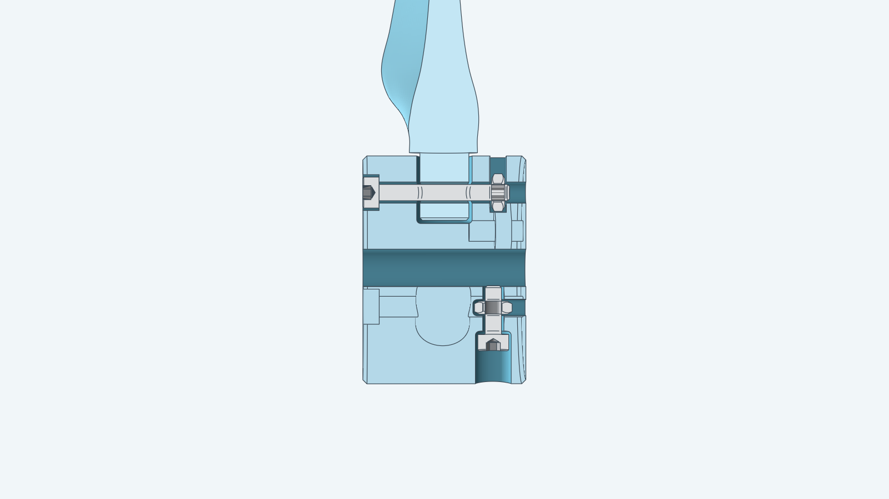
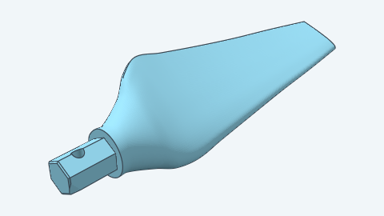
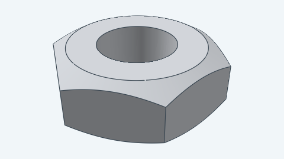
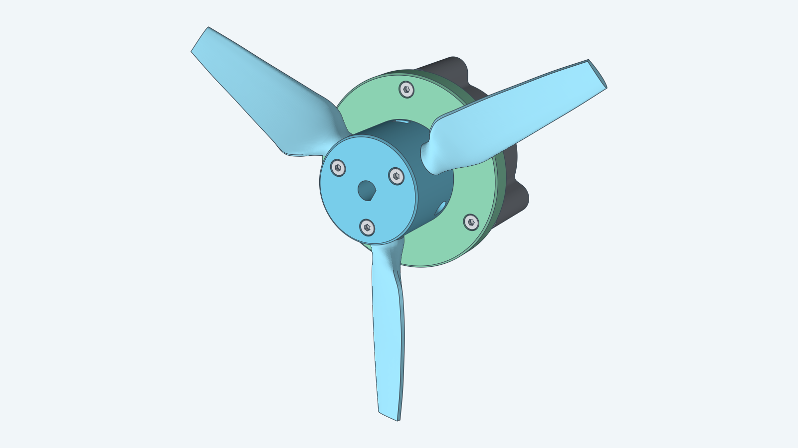
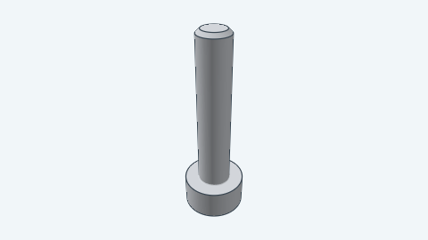
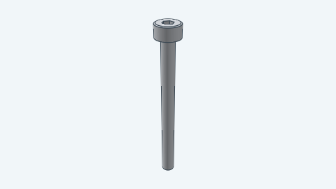

# Turbine fan

**Build status:** Not built yet. No physical copy of this model has been made and tested, so its dimensions and fits are unproven.

A three-blade fan whose blades are shaped like small wind turbine blades: with a thick round
root, a widest section near the hub, and a taper to a thin tip. The [hand-crank fan](../handcrankfan/) uses the same
blades. The hub is a plain round cylinder that holds a D-flat shaft with one M2 bolt used as a set screw, and each blade bolts into the hub on its own, so a blade can
be swapped. The same hub also bolts to the adapter ring of the [one-way clutch](../onewayclutch/) with two more M2 bolts,
instead of gripping a shaft, so the fan coasts when the shaft stops.

The fan comes in two hands. Seen from the front, the right-hand fan (the default) turns clockwise and the left-hand fan
counter-clockwise; either blows air forward, away from the mechanism. The left-hand blades are the right-hand blades
reflected, so a left-hand fan takes three left-hand blades. The pictures show the right hand.

The hub fits a shaft that runs in a purchased bearing, because the shaft's diameter equals the bearing's bore. The
default fits the 5 mm shaft of a 605ZZ bearing; a second preset fits the 8 mm shaft of a 608ZZ bearing.

**Clearance adjustment:** Mixed. The bore's clearance is a parameter; the blade fits, bolts and nuts keep their nominal size.

## Views

From the front, the D bore shows through the hub's front face, with the blade bolts' heads flush beside it.

From behind, the D bore shows in the back face, which goes against the mechanism, with its flat toward the set screw and
the set screw nut's slot in the back face. Two more small holes, at 30° and 150°, are the blind bolt holes that take the
clutch adapter's bolts.

From the side, the set screw's counterbore sits in the round face, the blade nut slots open below the blades (the two
adapter nut slots open there too, nearer the back face), and the blades show their twist.

## The set screw

One M2 x 6 bolt runs into the hub from the side, through a nut in a slot open to the back face, and presses the shaft's
flat. Its head sits below the round face, so nothing stands out of the hub. The D flat turns the hub with the shaft; the
screw stops the hub sliding along the shaft and rattling. The gallery's rules ask for a few sharp edges to stay on the hub,
which [instructions.md](instructions.md) lists: the D bore's two corners and the nut slot's end corner.

## Replacing a blade

Each blade has a round stud that slides into a radial socket in the hub. One M2 x 16 bolt runs parallel to the shaft, from
the hub's front face through the hub and the stud into an M2 nut. The nut sits in a slot open to the round face, below the
blade, so you can fit it with the hub on its shaft.

To remove a blade:

1. Undo its bolt from the front face. The nut is free in its slot: take it out through the slot's mouth below the blade
   root, or leave it.
2. Pull the blade out along its radial line. The stud leaves the socket after about 8 mm.

To fit a blade:

1. Slide an M2 nut, flat, into the slot's mouth in the round face below the socket until it stops at the slot's end.
2. Slide the stud into the socket with the blade's concave face toward the front face. The stud is round, so a blade also
   goes in turned half a turn, but then it faces the wrong way.
3. Push the bolt in from the front through the stud into the nut and tighten it.

All blades of one hand are one part and any of them fits any socket. The hub can stay on the shaft. To take the hub off its
shaft, loosen the set screw about two turns; it stays in its nut.

## Exploded

The set screw nut sits behind the hub in that view, so the same parts are shown again from behind.

## Parts

| Image | Name |
| --- | --- |
|  | Hub (printed), with or without the clutch adapter |
|  | Blade (printed), 3 |
|  | M2 × 16 socket head cap screw ([`models/m2bolt`](../m2bolt)), 3: the blade bolts |
|  | M2 × 6 socket head cap screw ([`models/m2bolt`](../m2bolt)), 1: the set screw |
|  | M2 hex nut ([`models/m2nut`](../m2nut)), 4 |

## Sizes

The 605ZZ hub (left) and the 608ZZ hub (right), from behind. They differ in the bore.

## On a one-way clutch

With `Mount` set to `ClutchMount` (`ParamsForClutch` fills it in from a clutch), the fan uses the same hub, with no flange and
no clamp ring, but it holds no shaft. Two M2 × 10 bolts from the rear of the [one-way clutch's](../onewayclutch/) adapter ring
run into nuts in the hub's two adapter slots, and the adapter bolts to the clutch's ears as its own README describes. The
shaft drives the fan through the clutch, and the fan coasts when the shaft stops or turns back. The fan is turned 60 degrees
from the clutch, so each ear bolt lies midway between two blades and a hex key reaches it from the front. The pictures show the
fan on the default (605ZZ, clockwise) clutch with its adapter.

The cutaway is cut by the plane x = 0, which holds one ear bolt, one adapter bolt and one of the clutch's own bolts.

**Hand and freewheel.** The ring is driven when the shaft turns the clutch's `Freewheel` direction and coasts that way about a
stopped shaft. A right-hand fan blows forward turning clockwise seen from the front.

| Fan `Hand` | Clutch `Freewheel` | Result |
| --- | --- | --- |
| `RightHand` | `Clockwise` | the shaft drives the fan forward and the fan coasts on when the shaft stops (matched) |
| `LeftHand` | `CounterClockwise` | the same, counter-clockwise (matched) |
| `RightHand` | `CounterClockwise` | the shaft drives the fan backward, toward the mechanism (mismatched) |
| `LeftHand` | `Clockwise` | backward, as above (mismatched) |

`ParamsForClutch` always returns a matched pair; a hand-built pair is not checked.

**Mounting space.** Leave room to hold an M2 nut in each of the ring's three rear ear pockets (r 19 to 24 mm at the ring's
rear face). In front are the adapter (51.4 mm across, 6 mm thick) and the fan. The shaft may end anywhere from inside the
clutch to the adapter's front face. It must not enter the hub: a shaft in the hub's D bore would lock the fan to the shaft and
defeat the clutch. The adapter's 10 mm bore clears it.

**Assembly.** The adapter's bolts into the hub cannot be reached once the adapter is on the clutch, and the adapter and the
hub cover the clutch's own bolt heads, so work in this order.

1. Fit the blades to the hub, as above.
2. Slide an M2 nut into each of the hub's two adapter slots from the round face. Set the hub on the adapter's front face,
   with the adapter's face pockets toward the back, and drive two M2 × 10 bolts from the adapter's rear pockets into the nuts.
3. Assemble the clutch off the shaft (see the clutch's README), press it on the shaft and tighten its three bolts. The
   2.6 mm access holes in the adapter pass a 1.5 mm hex key to those heads if you need to retighten them.
4. Hold an M2 nut in each of the ring's three rear ear pockets, set the adapter against the ring's front end and drive the
   three M2 × 25 ear bolts from the front between the blades with a 1.5 mm hex key.

**Printing.** The hub prints the same way as the plain hub: front face down, axis vertical, no supports.

| Image | Name |
| --- | --- |
|  | M2 × 10 socket head cap screw ([`models/m2bolt`](../m2bolt)), 2: the adapter bolts |
|  | M2 × 25 socket head cap screw ([`models/m2bolt`](../m2bolt)), 3: the ear bolts, with the adapter |

The clutch mount takes the hub, blades, blade bolts and blade nuts above, the adapter ring from the one-way clutch (printed,
`onewayclutch.BuildAdapter`), two M2 × 10 adapter bolts and two M2 nuts for them ([`models/m2nut`](../m2nut)), and the three
M2 × 25 ear bolts and three nuts that hold the adapter to the clutch. It needs no set screw. The hub's set screw hole and
slot stay empty.

## Parameters

All dimensions are in millimeters, angles in radians. `Params.Validate` rejects a value outside its limit with an error
that names it.

| Parameter | 605ZZ (default) | 608ZZ | Limit |
| --- | --- | --- | --- |
| `ShaftDiameter` | 5 | 8 | Above 0; keeps a 1.6 mm wall to the blade sockets (at most 8.1) |
| `FlatDepth` | 0.5 | 0.75 | Above 0, at most a quarter of `ShaftDiameter`, and leaving the shaft's flat 2 mm and the bore's flat 2.8 mm wide |
| `BoreClearance` | 0.05 | 0.05 | 0.05 to 0.5; for the 8 mm shaft 0.05 to 0.1 |
| `BladePitch` | 25° | 25° | 10° to 40°, the blade angle at 48 mm |
| `Hand` | `RightHand` | `RightHand` | `RightHand` or `LeftHand` |
| `Mount` | `ShaftMount` | `ShaftMount` | `ShaftMount` or `ClutchMount`; `ClutchMount` bolts the hub to a clutch's adapter ring and leaves out the set screw |
| `Placement` | none | none | A valid frame |

The hub is a cylinder 28 mm across and 20 mm long. The rotor is 128 mm across. One hub serves both mounts.

## Printing

Print the hub front face down, with its bore axis vertical, and each blade standing on its stud end. The hub needs no print
pause: every nut sits in a slot open to a face, so you put the nuts in after printing.

To assemble:

1. Hold the hub back face up and drop an M2 nut into the set screw slot. It stops at the slot's hexagonal end, in line with
   the hole.
2. Push the M2 x 6 set screw into the counterbore on the side of the flat and turn it into the nut about two turns. Stop
   while its tip is still out of the bore (look into the bore from the back).
3. Fit each blade as described above.
4. Press the hub onto the shaft, flat to flat, the flat toward the set screw, at least 6 mm deep.
5. Tighten the set screw with a 1.5 mm hex key until its tip presses the flat.

For how to build this fan from Go, see the [developer notes](../../docs/models/turbinefan.md). The construction is in
[instructions.md](instructions.md) and [steps.md](steps.md).
