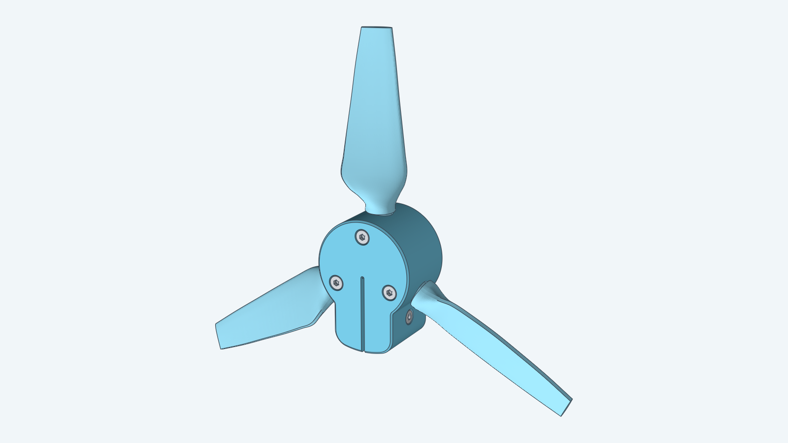
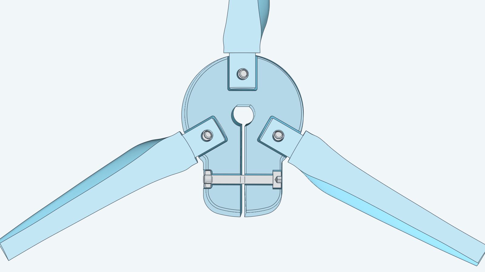
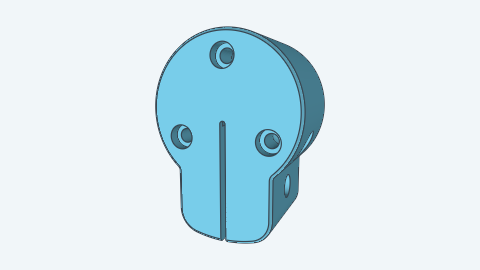
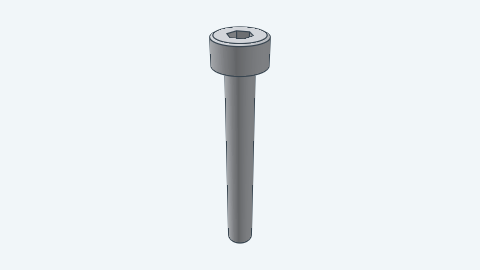

# Turbine fan

A three-blade fan whose blades are shaped like small wind turbine blades: the [hand-crank fan's](../handcrankfan/)
blade, with a thick round root, a widest section near the hub, and a taper to a thin tip. The hub clamps onto a D-flat
shaft the way the [crank handle](../crankhandle/) does, and each blade bolts into the hub on its own, so a blade can be
swapped.

The fan comes in two hands. Seen from the front, the right-hand fan (the default) turns clockwise and the left-hand fan
counter-clockwise; either blows air forward, away from the mechanism. The left-hand blades are the right-hand blades
reflected, so a left-hand fan takes three left-hand blades. The pictures show the right hand.

The hub fits a shaft that runs in a purchased bearing, because the shaft's diameter equals the bearing's bore. The
default fits the 5 mm shaft of a 605ZZ bearing; a second preset fits the 8 mm shaft of a 608ZZ bearing.

**Clearance adjustment:** Mixed. The bore's clearance is a parameter; the blade fits, bolts and nuts keep their nominal size.

## Views

From the front, the blade bolts' heads sit flush in the hub's front face.

From behind, the D bore and the slit show in the back face, which goes against the mechanism, with the clamp tab below
the bore.

From the side, the clamp bolt's head sits flush in the tab, and the blades show their twist.

## The clamp

A 1 mm slit runs from the D bore down through the clamp tab, and one M2 x 16 bolt across the tab closes it on the shaft.
The bolt's head sits flush in a pocket in one side face, and its nut sits in a hexagonal pocket open to the other side
face, so the bolt's tip ends flush with that face.

The tab is 18 mm wide. The gallery's rules ask for a few sharp edges to stay on the hub, which [instructions.md](instructions.md) lists:
the slit's edges, the clamp bolt's head pocket rim, the nut pocket's corners and the round of its floor. The two rounds
where the tab leaves the disc are 1 mm, smaller than the rule asks, because a bigger round would run into the sockets of
two blades.

## Replacing a blade

Each blade has a round stud that slides into a radial socket in the hub. One M2 x 16 bolt runs parallel to the shaft,
from the hub's front face through the hub and the stud into an M2 nut that the hub encloses.

To remove a blade:

1. Undo its bolt from the front face. The nut stays in the hub.
2. Pull the blade out along its radial line. The stud leaves the socket after about 8 mm.

To fit a blade:

1. Slide the stud into the socket with the blade's concave face toward the front face. The stud is round, so a blade
   also goes in turned half a turn, but then it faces the wrong way.
2. Push the bolt in from the front through the stud into the nut and tighten it.

All blades of one hand are one part and any of them fits any socket. The hub can stay on the shaft.

## Exploded

The blade nuts and the clamp nut sit behind the hub in that view, so the same parts are shown again from behind.

## Parts

| Image | Name |
| --- | --- |
|  | Hub (printed) |
|  | Blade (printed), 3 |
|  | M2 × 16 socket head cap screw ([`models/m2bolt`](../m2bolt)), 4: three blade bolts and the clamp bolt |
|  | M2 hex nut ([`models/m2nut`](../m2nut)), 4 |

## Sizes

The 605ZZ hub (left) and the 608ZZ hub (right), from behind. They differ in the bore.

## Parameters

All dimensions are in millimeters, angles in radians. `Params.Validate` rejects a value outside its limit with an error
that names it.

| Parameter | 605ZZ (default) | 608ZZ | Limit |
| --- | --- | --- | --- |
| `ShaftDiameter` | 5 | 8 | Above 0; keeps a 1.6 mm wall to the blade sockets (at most 8.1) |
| `FlatDepth` | 0.5 | 0.75 | Above 0 and at most a quarter of `ShaftDiameter` |
| `BoreClearance` | 0.05 | 0.05 | 0.05 to 0.5; for the 8 mm shaft 0.05 to 0.1 |
| `BladePitch` | 25° | 25° | 10° to 40°, the blade angle at 48 mm |
| `Hand` | `RightHand` | `RightHand` | `RightHand` or `LeftHand` |
| `Placement` | none | none | A valid frame |

The hub is 28 mm across and 20 mm long. The rotor is 128 mm across.

## Printing

Print the hub front face down, with its bore axis vertical, and each blade standing on its stud end. The hub needs one
print pause:

1. Slice the hub and add a pause at 17.6 mm above the bed, where the nut cavities' roofs start.
2. When the printer pauses, drop an M2 nut into each of the three round cavities. It lies flat.
3. Resume the print. The printer bridges the roof over the nuts.

To assemble:

1. Fit each blade and its bolt as described above.
2. Press the hub onto the shaft, flat to flat.
3. Set an M2 nut in the hexagonal pocket in one side of the tab, push the M2 x 16 clamp bolt in from the other side into
   it, and tighten it.

For how to build this fan from Go, see the [developer notes](../../docs/models/turbinefan.md). The construction is in
[instructions.md](instructions.md) and [steps.md](steps.md).
